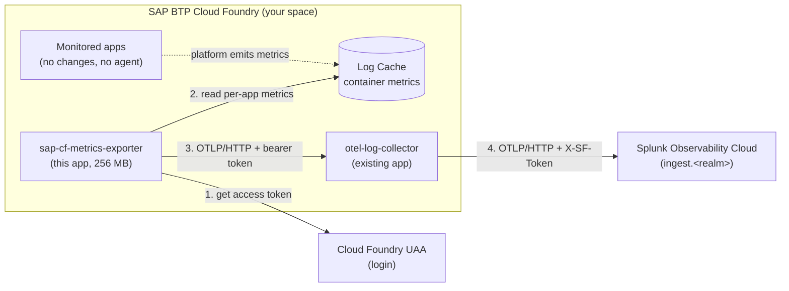

# sap-cf-metrics-exporter

Container metrics (CPU, memory, disk, uptime, log rate) for your SAP BTP Cloud Foundry apps in
Splunk Observability Cloud, **without installing anything in the monitored apps** and without a
UAA client that has `logs.admin`.

It is a small Cloud Foundry app. It signs in as an ordinary user, reads each app's container
metrics from Cloud Foundry's built-in **Log Cache**, and pushes them as OpenTelemetry metrics to
the `otel-log-collector` that already runs in your space.

- [How it works](#how-it-works)
- [Prerequisites](#prerequisites)
- [Quick start](#quick-start)
- [Authentication: choose how the exporter signs in](#authentication-choose-how-the-exporter-signs-in)
- [Configuration](#configuration)
- [What is sent to Splunk](#what-is-sent-to-splunk)
- [Operations](#operations)
- [Troubleshooting](#troubleshooting)
- [Security](#security)
- [Limitations](#limitations)
- [Repository layout](#repository-layout)

## How it works



Every cycle (60 seconds by default):

1. **Sign in.** The exporter gets a short-lived access token from UAA (about 20 minutes each) and
   renews it by itself.
2. **Discover.** It asks the Cloud Foundry API which apps exist in the configured orgs and spaces
   (empty lists mean everything the user can see).
3. **Read.** For each app instance it reads the latest container gauges from Log Cache
   (`GET /api/v1/read/<app-guid>?envelope_types=GAUGE`). This is the same data `cf app` shows.
4. **Push.** It converts them to OpenTelemetry gauges and sends them to the collector's
   `/v1/metrics` route. The collector's metrics pipeline forwards them to Splunk Observability Cloud.

Why this design: the Splunk Collector's `cloud_foundry` receiver needs a UAA client with
`logs.admin`, which SAP does not issue on SAP BTP. This exporter needs only a normal user with
read access to the spaces.

Logs are separate: apps send logs through the same collector to Splunk Cloud over HEC. See the
[top-level README](../README.md).

## Prerequisites

| You need | Notes |
| --- | --- |
| The `otel-log-collector` app running in the space | With the metrics overlay switched on: `OTEL_EXTRA_CONFIG=config.o11y-metrics.yaml`, plus `SPLUNK_O11Y_REALM` and `SPLUNK_O11Y_ACCESS_TOKEN` (an org access token with **ingest** scope) |
| A Cloud Foundry login | Read access to the spaces to monitor, for example Space Auditor. See [Authentication](#authentication-choose-how-the-exporter-signs-in) |
| The `cf` CLI, logged in to the target org and space | `cf target` shows them |
| Windows PowerShell 5.1+ or bash | **No Python is needed on your machine.** Python runs only inside the Cloud Foundry app |

A 2-minute pre-flight check and the collector steps are in
[`../RUNBOOK-cf-metrics.md`](../RUNBOOK-cf-metrics.md), Parts 0 and 1.

## Quick start

Run from the `exporter/` folder. The steps below use PowerShell; the runbook has the bash variants.

1. **Fill in the manifest.** Open `deploy/cf/manifest.push.yml` and replace every `<placeholder>`
   (API URL, org, space, apps, collector route). Get the values with `cf api` and `cf target`.
2. **Sign in.** For SSO: `cf login --sso`.
3. **Store the secrets** in the user-provided service `sap-cf-exporter-secrets`:

   ```powershell
   .\deploy\cf\set-exporter-secrets.ps1
   ```

   The script reads the collector's ingest token directly from `cf env`, so nothing is typed or
   pasted, and prints only key names, never values.
4. **Push.**

   ```powershell
   cf push -f deploy/cf/manifest.push.yml
   ```

5. **Check the logs** for a successful cycle:

   ```powershell
   cf logs sap-cf-metrics-exporter --recent | Select-String "Cycle|discovery|401|rejected" | Select-Object -Last 10
   ```

   `Cycle ok: N/N` means it works. Data appears in Splunk Observability Cloud within a couple of
   minutes, as metrics named `sap_cf_container_*`.

If the script is blocked after a ZIP download, run `Unblock-File .\deploy\cf\set-exporter-secrets.ps1`.

## Authentication: choose how the exporter signs in

Set `CF_AUTH_MODE` in the manifest to match the credential you stored.

| Mode | Stored keys | Use for | Lifetime |
| --- | --- | --- | --- |
| **`password`** | `cf_username`, `cf_password`, optional `cf_origin` | **Production.** A dedicated technical (non-SSO) user | Does not expire; the exporter logs in again by itself |
| `refresh_token` | `cf_refresh_token` | Proof of concept with an SSO user | **Expires after roughly 8 to 11 hours** on our test landscape. Needs a new `cf login --sso` and `set-exporter-secrets.ps1` about daily |
| `static_token` | `cf_bearer_token` | A quick demo only | About 20 minutes |
| `client_credentials` | `cf_client_id`, `cf_client_secret` | If a UAA client with `logs.admin` is ever granted | Does not expire |

### Production: a technical user (recommended)

SSO sessions need a person to renew them, so they cannot run unattended. Ask your BTP or identity
administrator for a **non-SSO technical user** with:

- **Space Auditor** on each space to monitor (use Space Developer only if Auditor cannot read Log Cache);
  also Org Auditor if available
- MFA exempted, because an automated login cannot answer a second factor
- the **origin name** of its identity provider, if the user lives in a custom provider such as
  SAP IAS (same as `cf auth --origin`)

Then:

```powershell
.\deploy\cf\set-exporter-secrets.ps1 -Mode password -Origin <origin-if-any>
# set CF_AUTH_MODE: password in deploy/cf/manifest.push.yml, then
cf push -f deploy/cf/manifest.push.yml
```

If the login fails with `invalid_grant` or `Bad credentials` for a correct password, check the
origin. Password mode has been unit-tested but not yet run against a live customer landscape.

### Renewing an SSO session (refresh_token mode)

```powershell
cf login --sso
.\deploy\cf\set-exporter-secrets.ps1
cf restage sap-cf-metrics-exporter
```

## Configuration

Set these in the manifest's `env:` block. Secrets never go there.

| Variable | Meaning |
| --- | --- |
| `METRICS_BACKEND` | `log_cache` (used here) or `stats_api` |
| `CF_API_URL` | `https://api.cf.<region>.hana.ondemand.com`. The Log Cache URL is derived from it (`api.` becomes `log-cache.`); set `LOG_CACHE_URL` only if yours differs |
| `CF_ORG_NAMES`, `CF_SPACE_NAMES`, `CF_APP_NAMES` | Which apps to read. Comma separated, or a JSON array if a name contains a comma, for example `["Acme, Inc._dev"]`. Empty means everything the user can see |
| `CF_AUTH_MODE` | See [Authentication](#authentication-choose-how-the-exporter-signs-in) |
| `OTLP_PUSH_ENDPOINT` | `https://<collector-route>/v1/metrics` |
| `DEPLOYMENT_ENVIRONMENT` | Sent as `deployment.environment.name` |
| `POLL_INTERVAL_SECONDS` | Default 60 |

Secrets come from the user-provided service `sap-cf-exporter-secrets`, delivered through
`VCAP_SERVICES`. Keys: `cf_username`, `cf_password`, `cf_origin`, `cf_refresh_token`,
`cf_bearer_token`, `cf_client_id`, `cf_client_secret`, and `otlp_push_token` (the collector's
`OTLP_INGEST_TOKEN`).

## What is sent to Splunk

Gauges, one series per app instance:

| Metric | Meaning |
| --- | --- |
| `sap_cf_container_cpu_usage_ratio` | Current CPU usage as reported by Cloud Foundry, passed through unscaled (the CF API does not state the unit) |
| `sap_cf_container_cpu_entitlement_ratio` | CPU usage relative to the instance's CPU entitlement, passed through unscaled. It is a usage ratio, not the entitlement itself |
| `sap_cf_container_memory_usage_bytes` / `_limit_bytes` | Memory in use and the app's memory quota |
| `sap_cf_container_disk_usage_bytes` / `_limit_bytes` | Disk in use and the app's disk quota |
| `sap_cf_container_uptime_seconds` | Seconds since the instance started |
| `sap_cf_container_log_rate_bytes_per_second` | Log throughput of the instance |
| `sap_cf_container_instance_running` | 1 if the instance is RUNNING, otherwise 0 (STARTING, CRASHED, DOWN, ...) |
| `sap_cf_container_usage_timestamp_seconds` | Unix time of the reading. Compare with the current time to spot usage that Cloud Foundry has not refreshed |

**Dimensions.** Resource: `service.name` (the Cloud Foundry app name) and
`deployment.environment.name`. Data point: `cf_instance_index` (plus `cf_process_type` for
non-web processes). They are kept to a minimum because Splunk Observability Cloud allows only a
limited number of new dimension key names per org per week.

A ready-made dashboard (8 charts, filtered by app and environment) can be generated from the
chart definitions in the source repository, under `deploy/splunk-o11y/`.

## Operations

| Task | Command |
| --- | --- |
| Status and logs | `cf app sap-cf-metrics-exporter`, `cf logs sap-cf-metrics-exporter --recent` |
| Change the monitored apps | Edit `CF_APP_NAMES` (or org/space) in the manifest and `cf push -f deploy/cf/manifest.push.yml`, or `cf set-env` then `cf restart` |
| Rotate credentials | Run `set-exporter-secrets.ps1` again, then `cf restage sap-cf-metrics-exporter` |
| Turn the metrics pipeline off | `cf unset-env otel-log-collector OTEL_EXTRA_CONFIG`, then `cf restart otel-log-collector`. Logs are unaffected |
| Remove everything | `cf delete sap-cf-metrics-exporter`, then `cf delete-service sap-cf-exporter-secrets` |

`cf restart` reuses the stored droplet; use `cf restage` after changing a bound service so the
secrets are re-read. Trial landscapes stop apps nightly, so start the exporter again with
`cf start`.

## Troubleshooting

| What you see in the exporter logs | Cause and fix |
| --- | --- |
| `UAA rejected the credentials (HTTP 401) ... refresh token is expired or revoked` | The SSO session ended. Run the three steps under [Renewing an SSO session](#renewing-an-sso-session-refresh_token-mode), or move to a technical user |
| `UAA rejected the credentials` in `password` mode | Wrong user or password, or a missing/incorrect `cf_origin` for a custom identity provider |
| `OTLP push rejected: HTTP 401` | The stored `otlp_push_token` does not match the collector's `OTLP_INGEST_TOKEN` (often a mangled paste). Run `set-exporter-secrets.ps1` again; it reads the token straight from the collector. Then `cf restage` |
| `Configured orgs not found/visible` and `Discovered 0 apps` | The user cannot see that org or space, or a name was split at a comma. Use a JSON array for names containing commas, and check `cf orgs` as that user |
| `Cycle ok` but nothing in Splunk, and the **collector** logs show `Exporting failed ... HTTP Status Code 401` to `ingest.<realm>` | The collector's `SPLUNK_O11Y_ACCESS_TOKEN` is wrong or lacks ingest scope. Test it, then store it with `cf set-env otel-log-collector SPLUNK_O11Y_ACCESS_TOKEN ...` and restart |
| `Cycle ok` but no new series in Splunk | Check `SPLUNK_O11Y_REALM` matches your org's realm and that `OTEL_EXTRA_CONFIG` is set on the collector |
| `no match found for python-x.y.z` while staging | `runtime.txt` names a version your landscape's Python buildpack no longer offers. Run `cf buildpacks` and pick an available 3.12.x |
| `cf` errors inside PowerShell about `NativeCommandError` | Use the provided `.ps1` scripts; they handle it. In your own scripts, call `cf` without `$ErrorActionPreference = "Stop"` |
| `curl` behaves oddly in PowerShell | In Windows PowerShell `curl` is an alias; use `curl.exe` |

## Security

- No secret is ever stored in the repository or the manifest. Credentials live only in the
  `sap-cf-exporter-secrets` service and are exported to the app process at start-up.
- The helper scripts read secrets from hidden prompts, `cf env`, or your local `cf` session; they
  write through a temporary file in your own temp folder that is deleted straight away, and they
  never print a value.
- A refresh token is equal to your personal session. Treat it like a password and prefer a
  technical user.
- Give the technical user the least role that works (Space Auditor). The exporter only reads.
- Rotate the technical user's password and the collector's `OTLP_INGEST_TOKEN` on your normal
  schedule, then run `set-exporter-secrets.ps1` and `cf restage`.
- All connections use HTTPS. The collector only accepts OTLP with its bearer token.

## Limitations

- Container metrics only (CPU, memory, disk, uptime, log rate). Application internals (JVM, HTTP
  latency, traces) come from APM, not this exporter.
- Log Cache keeps only a short window. If the exporter is down, the missed period is **not**
  back-filled.
- Instances are read once per cycle, so the resolution is the poll interval (60 seconds by default).
- One exporter reads one Cloud Foundry landscape. Use one instance per landscape or region.
- Verified with an SSO user on a trial and on a customer landscape. `password` mode is
  implemented and unit-tested but has not yet run against a live customer landscape.

## Repository layout

| Path | Purpose |
| --- | --- |
| `src/sap_cf_exporter/` | The exporter (Python 3.12, FastAPI, httpx) |
| `deploy/cf/manifest.push.yml` | Cloud Foundry manifest. Replace every `<placeholder>` before pushing |
| `deploy/cf/set-exporter-secrets.ps1` / `.py` | Create or update `sap-cf-exporter-secrets` without printing a secret (`-Mode`, `-Origin`, `-CollectorApp`, `-PromptForToken`, `-DryRun`) |
| `deploy/cf/run-exporter.sh` | Start script: reads the bound secrets service, then starts the exporter |
| `requirements.txt`, `runtime.txt` | Pinned dependencies and Python version for the Python buildpack |
| [`../RUNBOOK-cf-metrics.md`](../RUNBOOK-cf-metrics.md) | Step-by-step deployment for the collector and the exporter |
